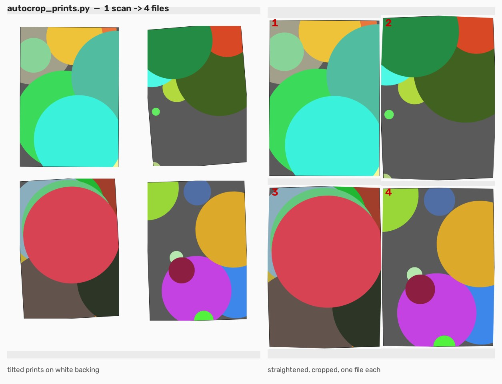

# autocrop-prints

Split a folder of flatbed scans into **one straightened file per print** — built for the
awkward case: several photos lying on a **white backing**, where `magick -trim` and
thresholding merge everything into one blob.



Detection is edge-based (multi-pass Canny plus an adaptive-threshold pass), the rotation
comes from `minAreaRect` geometry, and every crop is perspective-warped straight out of
the original scan — no re-compression of the source, no lossy intermediate.

## Background

This started as a simple script.

I had boxes of old family photos and a flatbed scanner, and every scan came back with
several prints on it — cropping them apart by hand, one by one, was not something I was
going to do a few thousand times. So I wrote a script: find each print on the scan,
straighten it, cut it out.

Then it grew. The script became an app so other people could use it, then so they could
use it from their phone, and then the interface took on a life of its own — batch
processing, fixing corners by hand, editing, ZIP export. That app is
[SmartPhotoCropper](https://smartphotocropper.com). Photo detection there is done by a
small neural network, which is what handles piles of overlapping prints and phone shots
taken at an angle.

This repo is the first step, kept as it was: no model, no browser, no account. OpenCV
only — edge detection, contours, `minAreaRect` for the rotation, a perspective warp per
print. Point it at a folder and it works.

## Quick start

```bash
pip install opencv-python-headless numpy

# whole folder -> <folder>/cropped/ , one TIFF per print + a contact sheet to check
python autocrop_prints.py /path/to/scans

# see what it would cut without writing anything
python autocrop_prints.py /path/to/scans --dry-run

# just want the one-file version? same detector, ~85 lines
python crop_prints.py /path/to/scans /path/to/out
```

| file | what it is |
|---|---|
| `autocrop_prints.py` | full CLI: batch folder, `--dry-run`, contact sheet per scan, 16-bit TIFF preserved, LZW output, split pass for two prints placed shoulder to shoulder |
| `crop_prints.py` | the same detector, compact — paste it anywhere, no flags |

## Flags (`autocrop_prints.py`)

| flag | default | what it does |
|---|---|---|
| `-o, --out` | `<input>/cropped` | output directory |
| `--margin` | `0.015` | inward trim per side, fraction — raises the leftover backing edge |
| `--min-area` | `0.008` | smallest print as a fraction of the scan |
| `--max-dim` | `2000` | detection resolution cap on the long side (detection only) |
| `--ext` | `.tif` | output format; `.tif` is LZW and keeps the original bit depth |
| `--sheet` / `--sheet-cols` | `contact_sheet.jpg` / `6` | QC sheet, one per input file |
| `--dry-run` | off | detect + contact sheet, no crops written |

Output names: `scan01.tif` → `scan01_01.tif`, `scan01_02.tif`, … A box holding two
touching prints is split and comes out as `scan01_04a.tif`, `scan01_04b.tif`.
**Originals are only ever read.**

## What it deliberately does not do

- **Does not decide which way up the photo is.** The crop is straightened and
  perspective-corrected, but a print placed sideways on the glass comes out sideways —
  telling a rotated photo from an upright one needs content recognition, not geometry.
- **Does not rescue a bleached print** with no visible border (an overexposed sky print
  on white paper): it usually finds a partial box. Fix that one by hand.
- **Does not guarantee the count.** Read the per-file count in the log and open the
  contact sheet. On 80 scans that glance takes two minutes and it is the whole QC step.

## Tested on

| scan | prints | found |
|---|---|---|
| 4 prints, 90° off, white backing, 4819×6874 flatbed scan | 4 | 4 |
| synthetic, 4 tilted prints, white backing | 4 | 4 |
| synthetic, 6 prints incl. a touching pair and one bleached print | 6 | 5 (+1 partial) |
| single print, 16-bit TIFF | 1 | 1 (16-bit preserved) |

## License

MIT — see `LICENSE`. Use it, fork it, ship it inside something commercial; a link back
is nice but not required.
